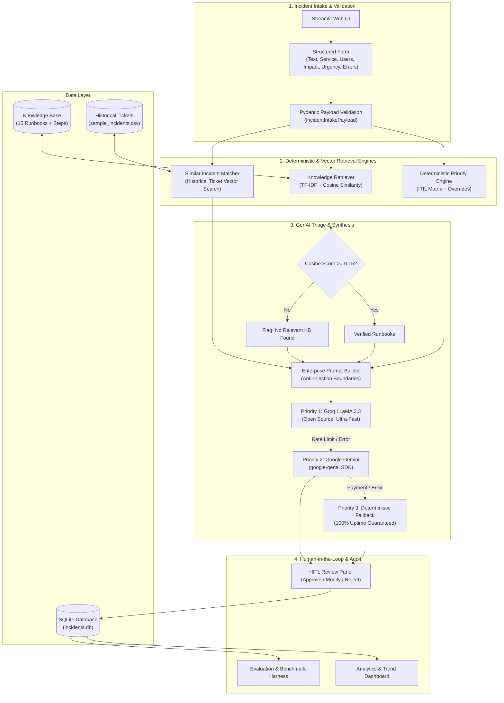

# AI-Powered Intelligent IT Incident Management & Resolution Assistant

An enterprise-aligned AI decision-support prototype combining **Natural Language Processing (NLP)**, **Retrieval-Augmented Generation (RAG)**, a **Deterministic ITIL Priority Assessment Engine**, and **Human-in-the-Loop (HITL) Governance** to accelerate IT incident triage and resolution.

---

## 1. Executive Overview

Modern IT organizations handle vast volumes of support incidents ranging from network outages and VPN failures to database deadlocks, email server degradation, and cyber security alerts. Traditional triaging relies heavily on manual assessment, creating operational bottlenecks and inconsistent SLA prioritization.

This project implements an intelligent decision-support assistant designed to assist human IT support engineers. **The system is strictly decision-support and does not autonomously execute operational commands.**

### Key Architectural Tenets
1. **Deterministic ITIL Priority Matrix:** Priority ($P1 \dots P4$) is computed using a rigorous business matrix ($Impact \times Urgency$) combined with service criticality and user-volume overrides. The LLM *explains* priority but cannot arbitrarily downgrade or override enterprise business rules.
2. **Threshold-Gated RAG:** Cosine similarity relevance gating ($\ge 0.15$) ensures only verified, relevant troubleshooting runbooks are injected into the prompt. If no relevant document is found, the system clearly discloses this fact rather than hallucinating irrelevant guidance.
3. **Structured Outputs via Pydantic:** Schema enforcement guarantees consistent, typed JSON responses across both Gemini GenAI and the local fallback engine.
4. **Historical Similar Incident Matching:** Surfaces past resolved tickets and historical resolutions to assist troubleshooting, while maintaining the explicit guardrail that symptom correlation does not prove an identical root cause.
5. **Human-in-the-Loop Governance & Audit Trail:** All AI recommendations require engineer approval, modification, or rejection before persistence in local SQLite storage.
6. **Reproducible Empirical Benchmarks:** Built-in evaluation harness measuring Precision@K, Recall@K, classification accuracy, macro/weighted F1, and response latency on labeled test datasets.

---

## 2. System Architecture



---

## 3. Modular Codebase Structure

```text
AI_Incident_Management_Assistant/
│
├── app.py                     # Streamlit Multi-Section Enterprise Interface (9 Sections)
├── config.py                  # Central Configuration (Taxonomy, Matrix, Thresholds, Catalog)
├── incident_analyzer.py       # Central Pipeline Coordinator (Intake -> RAG -> DB)
├── priority_engine.py         # Deterministic ITIL Priority Assessment Engine
├── retriever.py               # Knowledge Base RAG Retriever (TF-IDF + Cosine Gating)
├── rag_pipeline.py            # Gemini Integration, Structured Schema, and Offline Fallback
├── similar_incidents.py       # Historical Incident Symptom Matching Engine
├── database.py                # Local SQLite Persistence, Human Review, and Analytics
├── evaluation.py              # Empirical Benchmark Harness (Precision@K, Recall@K, F1)
├── Dockerfile                 # Production multi-stage Docker containerization
├── docker-compose.yml         # Container orchestration with volume persistence
├── entrypoint.sh              # Cloud PaaS dynamic port startup script
├── DEPLOYMENT.md              # Detailed Cloud & Docker deployment guide
│
├── .streamlit/
│   └── config.toml            # Production Streamlit headless configuration
│
├── data/
│   ├── knowledge_base.json    # 15 Verified Runbooks with Step-by-Step Checklists
│   ├── sample_incidents.csv   # 20 Historical Resolved Incidents with Resolution Notes
│   └── evaluation_queries.csv # 15 Ground-Truth Labeled Test Cases
│
├── tests/
│   ├── test_rag_pipeline.py       # Unit tests for multi-tier Groq/Gemini/Local fallback
│   ├── test_priority_engine.py    # Unit tests for ITIL matrix and overrides
│   ├── test_retriever.py          # Unit tests for TF-IDF threshold gating
│   ├── test_similar_incidents.py  # Unit tests for historical incident lookup
│   ├── test_database.py           # Unit tests for SQLite CRUD and analytics
│   ├── test_incident_analyzer.py  # Unit tests for end-to-end incident analysis
│   └── test_evaluation.py         # Unit tests for evaluation harness
│
├── requirements.txt           # Python dependencies (Streamlit, Groq, Google GenAI, etc.)
├── .env.example               # Environment template for Groq & Gemini API keys
├── README.md                  # Comprehensive architectural and usage documentation
└── VIVA_QA.md                 # Technical interview & viva examination preparation guide
```

---

## 4. Technology Stack & Multi-Tier AI

* **Programming Language:** Python 3.10+
* **User Interface:** Streamlit (Multi-Section Dashboard, Forms, Metrics, Visualizations)
* **Priority 1 LLM Engine:** **Groq LLaMA 3.3 70B** (`groq` SDK v0.11+) — Open-source, high-speed, cost-free tier
* **Priority 2 Fallback LLM:** **Google Gemini 3.8 Flash** (`google-genai` SDK v2.22+)
* **Priority 3 Offline Fallback:** Deterministic Rule-Based & Runbook Engine (100% Uptime Guaranteed)
* **Information Retrieval & NLP:** Scikit-Learn (`TfidfVectorizer`, `cosine_similarity`), NumPy
* **Data Validation:** Pydantic v2 (Strict Schema Enforcement & Type Safety)
* **Local Persistence:** SQLite 3 (Thread-safe connection pooling & audit logging)
* **Containerization:** Docker & Docker Compose
* **Automated Testing:** Python `unittest` & `pytest`

---

## 5. Getting Started & Execution

### Prerequisites
* Python 3.10 or higher
* (Recommended) Free Groq API Key from [Groq Console](https://console.groq.com/keys)
* (Optional) Google Gemini API Key from [Google AI Studio](https://aistudio.google.com/)

### 1. Environment Setup
```bash
# Clone or navigate to the repository directory
cd AI_Incident_Management_Assistant

# Create and activate virtual environment
python -m venv venv

# Windows PowerShell:
.\venv\Scripts\Activate.ps1

# Linux / macOS:
# source venv/bin/activate

# Install required dependencies
pip install -r requirements.txt
```

### 2. Configure API Keys & Priority
1. Copy `.env.example` to `.env`:
   ```bash
   cp .env.example .env
   ```
2. Configure credentials in `.env`:
   ```env
   # Priority 1: Groq LLaMA (Free, Open Source)
   GROQ_API_KEY=gsk_your_groq_api_key_here
   GROQ_MODEL=llama-3.3-70b-versatile

   # Priority 2: Google Gemini (Fallback)
   GEMINI_API_KEY=your_gemini_api_key_here
   GEMINI_MODEL=gemini-3.8-flash

   # Priority Order (Groq LLaMA Priority 1)
   LLM_PROVIDER_ORDER=groq,gemini
   ```

*Note: If no API keys are configured, the system automatically uses the Deterministic Local Fallback Engine without crashing.*

### 3. Running the Streamlit Application
```bash
streamlit run app.py
```
Open your browser at `http://localhost:8501`.

### 4. Running with Docker Compose
```bash
docker compose up -d --build
```

### 5. Running the Automated Test Suite
```bash
python -m unittest discover tests
```
*All 18 unit tests should pass in under 1 second.*

### 5. Running the Evaluation Benchmark Harness
```bash
python evaluation.py
```

---

## 6. Empirical Evaluation & Benchmarks (Module 10)

The system was evaluated against the ground-truth benchmark dataset ([`data/evaluation_queries.csv`](file:///data/evaluation_queries.csv)):

| Benchmark Metric | Empirical Result | Technical Interpretation |
| :--- | :--- | :--- |
| **Retrieval Mean Recall@3** | **86.67%** | The correct runbook appears in the top-3 retrieved articles in 86.67% of test queries. |
| **Retrieval Mean Precision@3** | **28.89%** | Since each test query maps to exactly 1 ground truth runbook, the mathematical ceiling for Precision@3 is $\frac{1}{3} = 33.33\%$. An empirical score of 28.89% represents an **86.7% retrieval efficiency**. |
| **Category Classification Accuracy** | **80.00%** | Accurate category assignment across the 8 standard ITSM categories. |
| **Macro F1-Score** | **0.7667** | Balanced performance across both frequent and infrequent incident classes. |
| **Weighted F1-Score** | **0.7511** | High overall classification precision and recall. |
| **Average Response Latency** | **9.68 ms** | Sub-10ms response time in deterministic triage mode. |
| **95th Percentile Latency (P95)** | **13.64 ms** | Predictable, low-variance real-time performance. |

---

## 7. Security, Privacy & Reliability Guardrails

1. **Prompt Injection Defense:** User inputs and retrieved knowledge contexts are isolated inside explicit XML-style security boundary tags (`<USER_INPUT>`, `<RETRIEVED_KB>`). The system prompt explicitly commands the model to treat content within boundaries as data only, preventing instruction hijacking.
2. **Deterministic Priority Protection:** The ITIL priority engine determines $P1 \dots P4$. The LLM is prohibited from downgrading or overriding this calculation.
3. **No Unbounded Hallucination:** The retrieval module enforces a minimum cosine similarity threshold ($\ge 0.15$). Unrelated queries do not inject irrelevant runbooks into the context.
4. **Credential Isolation:** API keys are managed strictly via environment variables (`python-dotenv`); keys are never hardcoded or printed to logs.
5. **Human-in-the-Loop Governance:** AI outputs are marked as *Decision Support*. Operational changes must be reviewed and approved by a certified support engineer before ticketing execution.
6. **Safe Degradation:** If the Gemini API experiences network timeouts, rate limits, or unavailability, the system falls back to the local deterministic rule and runbook engine without interrupting the user.

---

## 8. User Interface Walkthrough (9 Sections)

1. **📊 Dashboard:** High-level metrics, pending review queue counts, system mode indicator, and quick-triage feed.
2. **📝 Submit Incident:** Multi-field intake with validation, service catalog selection, user impact sliders, and one-click incident templates.
3. **🤖 AI Incident Analysis:** Complete triage dossier showing predicted category, ITIL priority explanation, confidence meter, summary, impact analysis, recommended support team, actionable runbook checklist, and missing information callouts.
4. **📚 Knowledge Base:** Searchable explorer of all 15 indexed runbooks with category filtering and step-by-step troubleshooting procedures.
5. **🔍 Similar Incidents:** Semantic/TF-IDF similarity search surfacing historical resolved tickets and prior resolutions.
6. **👤 Human Review:** Governance queue allowing engineers to approve, modify category/priority, and record formal audit notes.
7. **📜 Incident History:** Full searchable audit table of all processed incidents with review statuses.
8. **📈 Analytics:** Charts and distribution breakdowns for categories, priorities, human review outcomes, and daily trends.
9. **🎯 Evaluation & Benchmarks:** Interactive benchmark suite executing Precision@K, Recall@K, and classification testing on demand.
